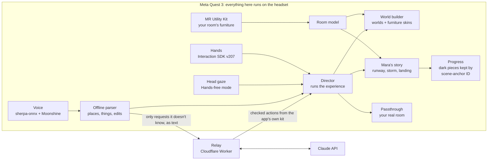

# Worldeck

**Every word is a door. Someone on the other side needs you.**

Worldeck turns your real room into any world you name, and puts someone in it who needs you. It is a mixed-reality story for **Meta Quest 3**, made for the Meta VR Start Developer Competition 2026 (Entertainment). You play seated, with your hands only. No controllers are needed, and voice is optional.

## Try it

- **On Meta Quest 3:** https://www.meta.com/s/27ZW3IDM7J
- **Trailer (2 min):** https://youtu.be/LkcN4o6Cvcw
- **Full guide:** [HOW-TO-PLAY.md](HOW-TO-PLAY.md)

## Testing instructions

1. **Set up your room once.** On the Quest, run *Settings → Physical space → Space Setup*, and make sure your table is in it. Your furniture becomes part of every world. Without a scan, Worldeck still works and uses a virtual table.
2. **Sit at your table,** open Worldeck, and put down your controllers. Everything is done with your hands.
3. **First, choose your light:** *Full effects* or *Calm effects* (Calm removes all flashes).
4. **Touch Juniper** (the small light with eyes) and pick an animal. It appears on your real table. Pick it up and bring it to your face to see its real size.
5. **Touch "See where it lives".** Your room dissolves into its world.
6. **Touch "Answer her call".** Mara's story begins: hold an open palm in each glowing ring to block the meteors, then hold out your palm, face up, for her ship to land.
7. **The menu** is the button on your left wrist. *Comfort & access* has Hands-free mode (look at a button to press it), big captions and a gentler storm.

The whole story takes about 15 minutes. Everything except composing brand-new places works offline.

## What you can do

- **Say a place, and go there.** Over 340 real places work offline, from India to Iceland. Claude composes anything else from the app's own kit.
- **Change it with a word.** "Make it rain." "Make it night." "Add northern lights."
- **Make things, and see their real size.** "Make me a lion", then pick it up and its card tells you how big it is in life.
- **Meet the locals.** Someone lives in every world. Wave, and they wave back. Next time, they remember you.
- **Mara's story.** Your furniture becomes her runway. Miss a meteor, and your real room breaks through and that piece goes dark. **Your room remembers**: it stays dark in the next chapter until you light it again. Then she lands in your hand, and her story ends in your own room, with her keepsakes on your table.

## How it works



| Part | Where |
|---|---|
| The experience | `Assets/Worldeck/Scripts/Runtime/Director.cs` |
| Your room and furniture | `RoomSource.cs`, `RoomModel.cs`, `RoomShell.cs`, `Skins.cs` |
| Worlds | `WorldBuilder.cs`, `Props.cs`, `WorldLook.cs` |
| Mara's story | `Mission.cs`, `Emergency.cs` (the storm), `Scripts/Core/Story.cs` (every line) |
| Hands | `Gather.cs`, `PokeButton.cs`, `HandPanel.cs` |
| On-device voice and the offline parser | `Ears.cs`, `Scripts/Core/Words.cs`, `Wishes.cs`, `Atlas.cs` |
| Saved progress (dark pieces, keepsakes, streak) | `Scripts/Core/Progress.cs` |
| The relay to Claude | `proxy/` |

## The research behind it

Every major design choice comes from published research or Meta's own guidance:

- **Your furniture as the world's objects.** [Substitutional Reality](https://dl.acm.org/doi/10.1145/2702123.2702389) (Simeone, Velloso and Gellersen, CHI 2015) showed that pairing each real object with a virtual one makes a virtual world feel physically present. Worldeck rebuilds each piece of your furniture: your table becomes a fire ring, your sofa a log bench.
- **Real sizes that look real.** People judge distance from continuous ground ([Sinai, Ooi and He, *Nature* 1998](https://www.nature.com/articles/26747)) and from the angle below the horizon ([Ooi, Wu and He, *Nature* 2001](https://www.nature.com/articles/35102562)). So each world's ground runs unbroken from your feet, and its horizon sits at your seated eye height.
- **Things that sit on your real table.** Dark, simple shadows help people see that a virtual object touches a real surface ([Adams et al., 2022](https://arxiv.org/abs/2201.01889)). Everything you make casts one.
- **One gesture, used everywhere.** Meta's [hands best practices](https://developers.meta.com/horizon/design/hands-best-practices/) say to teach one core interaction and reuse it. The open palm blocks a meteor, waves to a local and catches Mara's ship.
- **Sessions that fit a day.** Meta's guidance on [session length](https://developers.meta.com/horizon/blog/optimize-user-time-goldilocks-session-length-meta-quest/) shaped the short chapters and the daily world.
- **Light that is safe for everyone.** The Full or Calm choice before any storm follows [Xbox Accessibility Guideline 118](https://learn.microsoft.com/en-us/gaming/accessibility/xbox-accessibility-guidelines/118), [WCAG 2.3.1](https://www.w3.org/WAI/WCAG21/Understanding/three-flashes-or-below-threshold.html) and South et al., [*Barriers to Photosensitive Accessibility in Virtual Reality*](https://dl.acm.org/doi/10.1145/3613904.3642635) (CHI 2024). Nothing ever flashes more than three times a second.

## Made for everyone

- **Hands-free mode:** look at a button, a piece or a meteor's ring to use it. You can finish the story without lifting a hand.
- **One hand is enough,** and a gentler storm is available.
- **Every line is captioned,** with an option for big text.
- **Stand up,** and the world fades back to your room while the storm waits.
- **Your voice never leaves the headset.** Only requests the app doesn't know go out, as text.

## What's next, and the research it builds on

- **Step inside real places** at full scale, with [photorealistic 3D tiles](https://developers.google.com/maps/documentation/tile/3d-tiles) and [3D Gaussian Splatting](https://arxiv.org/abs/2308.04079) (Kerbl et al., SIGGRAPH 2023).
- **Play together,** in one room or two homes, with Meta's [Shared Spatial Anchors](https://developers.meta.com/horizon/documentation/unity/unity-shared-spatial-anchors/).
- **Scenes from one sentence,** following [LayoutGPT](https://arxiv.org/abs/2305.15393) (NeurIPS 2023) and [Text2Room](https://arxiv.org/abs/2303.11989) (ICCV 2023).
- **Locals with long memories,** following [*Generative Agents*](https://arxiv.org/abs/2304.03442) (Park et al., UIST 2023).
- **Your real objects in the story,** with the Quest 3 [Depth API](https://developers.meta.com/horizon/documentation/unity/unity-depthapi-occlusions-advanced-usage/).
- **More of Mara,** more languages, Quest 3S tuning, and Early Access on the Meta Horizon Store in 2027.

## Build and test it yourself

Requirements: Unity 6000.0.85f1 with Android support, and Unity Hub running. Then from the project folder:

```bash
U="path/to/Unity.exe"; P="$(pwd)"
"$U" -batchmode -quit -projectPath "$P" -executeMethod Worldeck.EditorTools.WorldeckSetup.Setup -logFile Tools/setup.log
"$U" -batchmode -projectPath "$P" -runTests -testPlatform EditMode -testResults Tools/editmode-results.xml
"$U" -batchmode -projectPath "$P" -runTests -testPlatform PlayMode -testResults Tools/playmode-results.xml
"$U" -batchmode -quit -projectPath "$P" -executeMethod Worldeck.EditorTools.WorldeckSetup.BuildApk -logFile Tools/build.log
```

- **EditMode tests** (428 cases, all passing) cover Mara's lines and choices, the offline parser, places, share codes and saved progress.
- **PlayMode tests** run the whole story in every MR Utility Kit sample room: her call, the storm, pieces going dark and lighting again, the landing and exploring.
- **The relay's tests:** `cd proxy && npm test` (59 tests, all passing).

Voice and AI are optional. Without a relay, the app offers choices instead.

## Credits

- **Models:** Kenney (www.kenney.nl): Nature Kit, Holiday Kit, Space Kit, Space Station Kit, City Kit (Commercial, Roads), Furniture Kit, and Mini Characters (Mara's figure). All CC0; licence files are in `Tools/kit/licences/`.
- **Speech on the headset:** sherpa-onnx with Moonshine and Silero VAD (open source).
- **Mara's voice:** recorded offline with Kokoro-82M (Apache-2.0) through sherpa-onnx.
- **Meta XR SDK, MR Utility Kit and Interaction SDK** for hands, passthrough and the room scan.
- **Claude** (Anthropic) composes new places and lets the locals answer in character.

Worldeck's design and code were written from November 11, 2026, inside the competition window. See [THIRD-PARTY-NOTICES.md](THIRD-PARTY-NOTICES.md) for licences.
